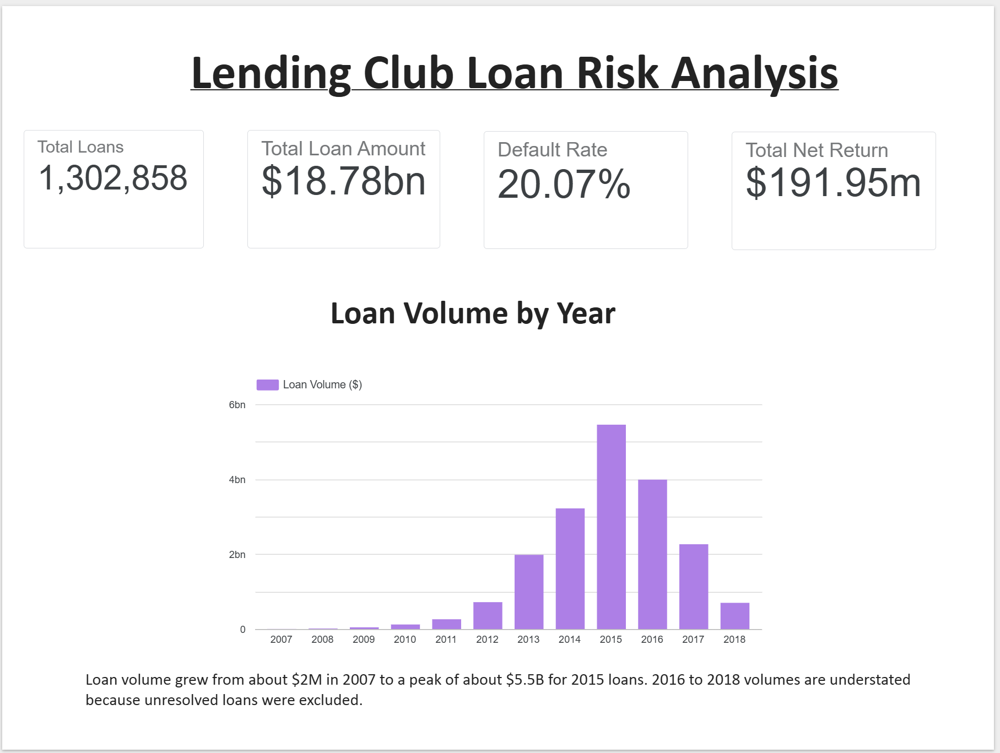
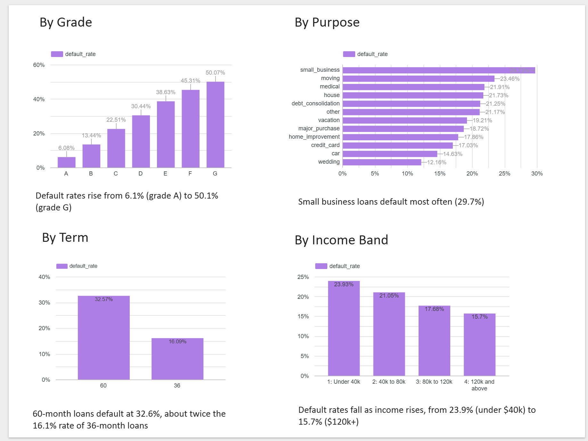
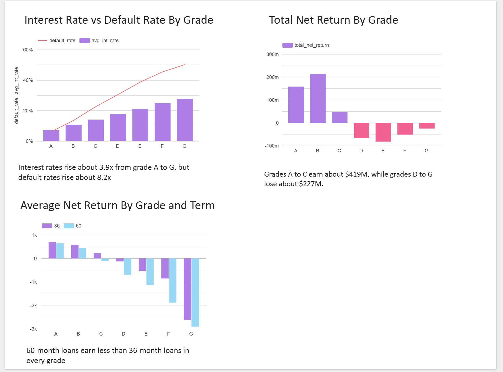

# Lending Club Loan Risk Analysis

**Which loans make money for a lender, and which ones lose it?**

An end-to-end analytics project on 1.3 million resolved peer-to-peer loans: cleaning in Python, modelling and analysis in BigQuery SQL, and an interactive Looker Studio dashboard.

**Dashboard:** [Add Looker Studio link here]

---

## Business question

A lender wants to know where its loan portfolio earns money and where it loses it. This project answers five questions:

1. Which loan grades carry the most default risk?
2. Do interest rates compensate for that risk?
3. Does loan term (36 vs 60 months) change the picture?
4. Which borrower purposes and states are most and least profitable?
5. What should a lending team change?

## Summary of findings

| # | Finding | Evidence |
|---|---|---|
| 1 | Default risk rises steeply with grade | 6.1% (grade A) to 50.1% (grade G) |
| 2 | Higher interest rates do not offset the extra risk | Rates rise about 3.9x, default rates about 8.2x; average return per loan turns negative from grade D |
| 3 | 60-month loans underperform 36-month loans in every grade | Grade C earns about +$219 per loan at 36 months but loses about $118 at 60 months |
| 4 | Two purposes generate almost all the profit | Credit card and debt consolidation: about +$231M combined; small business has the highest default rate at 29.7% |
| 5 | Returns vary widely by state | Illinois ranks first at +$22.9M; Florida and New York are the largest losers at -$7.3M and -$6.5M |

Overall, the portfolio earned an estimated **+$192M** (see the definition of net return below), with an overall default rate of about **20.1%**.

## Dataset

- **Source:** Lending Club loan data downloaded from Kaggle (uploaded by user `KA-KA-shi`). The original data is published by Lending Club.
- **File used:** [add exact file name, e.g. `loan.csv`]
- **Downloaded:** 26/10/2026
- **After cleaning:** 1,302,858 resolved loans issued between 2007 and 2018.

## Tools

- **Python (pandas):** data cleaning, run in Google Colab
- **BigQuery SQL:** data modelling and analysis (CTEs, window functions, views)
- **Looker Studio:** interactive dashboard
- **Git and GitHub:** version control and documentation

## Approach

1. **Clean** the raw file in Python (`notebooks/01_cleaning.ipynb`). Every decision is recorded in [`docs/cleaning_log.md`](docs/cleaning_log.md).
2. **Load** the cleaned table into BigQuery and validate it against pandas (row count and totals both matched at 1,302,858 rows).
3. **Model** helper columns in a SQL view (`sql/01_create_views.sql`): issue date, income band and net return.
4. **Analyse** the business questions with SQL (`sql/02_analysis.sql`).
5. **Visualise** the results in a Looker Studio dashboard.

### Key cleaning decisions

| Decision | Reason |
|---|---|
| Kept only loans with a known outcome (Fully Paid, Charged Off, Default) | "Current" and "In Grace Period" loans have not finished, so including them would understate risk |
| Defined `is_default` as 1 for Charged Off or Default, and 0 for Fully Paid | Gives a simple default rate when averaged |
| Dropped the `id` column | 100% of its values were missing in this file version; replaced it with a row-based `loan_key` |
| Filled missing `emp_length` (about 6.5% of rows) with "Unknown" | Keeps the loans and lets "Unknown" be analysed as its own group |
| Removed rows with `dti` below 0 or above 100, and `annual_inc` of 0 or less | Impossible or unusable values |
| Found 4 rows matching on 9 key columns; [removed / kept] them | [add reason from your notebook] |

### Definitions

- **Default rate:** share of resolved loans that were charged off or defaulted.
- **Net return (per loan):** `total_rec_int + total_rec_prncp - funded_amnt`, which is interest received plus principal repaid minus the amount funded. It is an approximation (see Limitations).

---

## Key findings

### Finding 1: Default risk rises steeply with grade

Default rates increase at every step from grade A to G, about 8 times higher at the top of the risk scale. This is the expected pattern and a useful check that the data was cleaned and labelled correctly.

| Grade | Loans | Share of loans | Default rate |
|---|---:|---:|---:|
| A | 226,181 | 17.36% | 6.08% |
| B | 379,978 | 29.16% | 13.44% |
| C | 369,677 | 28.37% | 22.51% |
| D | 195,129 | 14.98% | 30.44% |
| E | 91,501 | 7.02% | 38.63% |
| F | 31,459 | 2.41% | 45.31% |
| G | 8,933 | 0.69% | 50.07% |

### Finding 2: Interest rates do not keep pace with risk

Interest rates rise from 7.12% to 27.68% across grades (about 3.9 times), but default rates rise from 6.08% to 50.07% (about 8.2 times). Average net return per loan turns negative at grade D.

| Grade | Avg interest rate | Default rate | Avg net return per loan | Total net return |
|---|---:|---:|---:|---:|
| A | 7.12% | 6.08% | +$698 | +$157.9M |
| B | 10.69% | 13.44% | +$564 | +$214.4M |
| C | 14.02% | 22.51% | +$126 | +$46.6M |
| D | 17.70% | 30.44% | -$342 | -$66.7M |
| E | 21.10% | 38.63% | -$904 | -$82.7M |
| F | 24.90% | 45.31% | -$1,652 | -$52.0M |
| G | 27.68% | 50.07% | -$2,861 | -$25.6M |

- Grades A to C earn about **+$419M**. Grades D to G lose about **-$227M**, offsetting more than half of those gains.
- Grades D to G make up about 25% of all loans but account for all of the losses.
- Grades A and B are 46.5% of loans and produce about 89% of the gains from A to C.
- Grade C is 28% of volume but earns only about $47M, so it is the borderline grade.

### Finding 3: Loan term adds a second layer of risk

Comparing 36-month and 60-month loans within the same grade shows that 60-month loans have higher default rates and lower returns in every grade.

| Grade | Default rate (36m) | Default rate (60m) | Avg return (36m) | Avg return (60m) | Share of grade on 60m |
|---|---:|---:|---:|---:|---:|
| A | 5.96% | 10.48% | +$699 | +$653 | 2.7% |
| B | 12.80% | 18.10% | +$582 | +$431 | 12.1% |
| C | 20.59% | 27.54% | +$219 | -$118 | 27.6% |
| D | 26.95% | 36.34% | -$131 | -$698 | 37.1% |
| E | 32.90% | 42.19% | -$532 | -$1,135 | 61.6% |
| F | 38.34% | 47.36% | -$858 | -$1,885 | 77.3% |
| G | 48.36% | 50.41% | -$2,616 | -$2,909 | 83.6% |

- Grade still matters within each term: among 36-month loans only, grades A to C are profitable and D to G are not. So term does not explain away the grade effect.
- **Grade C flips from profit to loss** depending on term (+$219 vs -$118 per loan).
- The riskiest grades rely most on 60-month loans (84% of grade G), so the two risk factors stack.

### Finding 4: Credit card and debt consolidation loans generate almost all the profit

Only purposes with at least 1,000 loans are shown.

| Purpose | Loans | Default rate | Total net return |
|---|---:|---:|---:|
| credit_card | 285,567 | 17.03% | +$123.9M |
| debt_consolidation | 757,150 | 21.25% | +$106.9M |
| home_improvement | 84,427 | 17.86% | +$6.2M |
| wedding | 2,294 | 12.16% | +$3.0M |
| car | 14,117 | 14.63% | +$2.3M |
| vacation | 8,728 | 19.21% | -$2.0M |
| house | 6,962 | 21.73% | -$2.7M |
| moving | 9,162 | 23.46% | -$2.8M |
| medical | 15,014 | 21.91% | -$4.6M |
| small_business | 15,003 | 29.73% | -$11.9M |
| major_purchase | 28,317 | 18.72% | -$12.7M |
| other | 74,880 | 21.17% | -$13.5M |

- Credit card and debt consolidation loans are about 80% of all loans and earn about +$231M combined. Credit card loans earn more in total than debt consolidation despite far fewer loans.
- Small business loans have the highest default rate (29.7%) and lose about $11.9M.
- **Major purchase loans** default at a below-average rate (18.72%) but still lose money. This analysis does not explain why, and it would be worth investigating (for example, grade or term mix).

### Finding 5: Geography matters, but needs careful reading

| Rank | State | Loans | Default rate | Net return |
|---:|---|---:|---:|---:|
| 1 | IL | 50,010 | 18.23% | +$22.9M |
| 2 | WA | 28,330 | 15.89% | +$19.9M |
| 3 | CO | 28,829 | 15.60% | +$17.2M |
| 4 | GA | 42,013 | 18.43% | +$15.9M |
| 5 | CA | 190,933 | 19.71% | +$14.9M |
| 47 | NV | 19,631 | 22.05% | -$3.1M |
| 48 | LA | 15,010 | 23.38% | -$3.5M |
| 49 | MS | 6,312 | 26.19% | -$3.9M |
| 50 | NY | 106,359 | 22.15% | -$6.5M |
| 51 | FL | 92,575 | 21.57% | -$7.3M |

- 38 of 51 regions (50 states plus DC) have a positive net return, and 13 have a negative one.
- Default rates range from 13.12% (DC) to 26.19% (MS).
- New York and Florida are large markets with returns below zero, so they have the biggest effect on the total.
- Ranking by total net return mixes market size with loan quality. A small state with a high default rate can still rank above a large one.
- Iowa has only 7 loans, so its figures are not meaningful.

### Context: trends over time

| Year | Loans | Volume ($M) | Avg loan size | Default rate |
|---|---:|---:|---:|---:|
| 2007 | 251 | 2.2 | $8,842 | 17.93% |
| 2008 | 1,562 | 14.4 | $9,213 | 15.81% |
| 2009 | 4,716 | 46.4 | $9,847 | 12.60% |
| 2010 | 11,536 | 122.1 | $10,586 | 12.89% |
| 2011 | 21,721 | 261.7 | $12,048 | 15.18% |
| 2012 | 53,367 | 718.4 | $13,462 | 16.20% |
| 2013 | 134,793 | 1,982.4 | $14,707 | 15.60% |
| 2014 | 221,468 | 3,221.7 | $14,547 | 18.54% |
| 2015 | 373,402 | 5,456.4 | $14,613 | 20.16% |
| 2016 | 274,611 | 3,989.3 | $14,527 | 24.27% |
| 2017 | 158,489 | 2,264.4 | $14,287 | 22.89% |
| 2018 | 46,942 | 700.3 | $14,918 | 14.71% |

- Lending volume grew sharply from 2007 to 2015, and average loan size rose from about $8,800 to about $14,600 before levelling off.
- Default rates rose from about 13% in 2009 to 2010 to a peak of 24.3% for 2016 loans. I did not test whether this reflects a riskier grade mix or something else.
- **The drop in volume and default rate for 2017 and 2018 is mostly a data artefact, not a real improvement.** Many recent loans were still active and were excluded because their outcome was unknown, leaving only the fastest-resolving loans.
- Very early years (2007, 2008) have few loans, so their rates are noisy.

---

## Recommendations

These are hypotheses suggested by the data, not proven effects. The analysis describes past loans and cannot show what would happen if lending rules changed.

1. **Reprice or tighten approval for grades D to G.** They lose money on average despite higher interest rates.
2. **Review 60-month terms for grade C and below.** Grade C is profitable at 36 months but loses money at 60.
3. **Prioritise growth in grades A and B** and in credit card and debt consolidation loans, which generate most of the return.
4. **Investigate small business, major purchase and "other" loans**, which lose money in total, and find out whether the cause is grade mix, term or the purpose itself.
5. **Check Florida and New York** for what drives their losses, since they are large and negative.

## Limitations

- **Net return is an approximation.** It excludes any money recovered after a charge-off, fees, and the time value of money, so it likely overstates losses on defaulted loans.
- **Only resolved loans are included.** Recent years look safer than they are, and 60-month loans, which resolve later, may be under-represented among recent years.
- **Early repayment** reduces interest earned, so some paid-off loans show lower returns than their stated rate implies.
- **Findings are descriptive, not causal.** For example, I did not test whether state or purpose differences are explained by grade or term mix.
- **One lender, one country, one period.** Results may not generalise.
- **Purposes with fewer than 1,000 loans** were excluded from the purpose analysis.

## Dashboard

[Add Looker Studio link here]





## How to reproduce

1. Download the Lending Club dataset from Kaggle and place the `accepted_...` CSV in a Google Drive folder.
2. Open `notebooks/01_cleaning.ipynb` in Google Colab, update the `path` variable to your file location, and run all cells. The notebook uses Colab-specific code (`google.colab`) to mount Google Drive. Use your own Google Cloud project ID to create `lending_club.loans_clean`.
4. Run `sql/01_create_views.sql`, then the queries in `sql/02_analysis.sql`, replacing `your-project-id` with your project ID.

## Repository structure

```
├── README.md
├── notebooks/
│   ├── 01_cleaning.ipynb
├── sql/
│   ├── 00_validation.sql
│   ├── 01_create_views.sql
│   └── 02_analysis.sql
├── dashboard/        (screenshots)
└── docs/
    ├── cleaning_log.md
    └── data_dictionary.md
```

Raw and cleaned data files are not included in the repository because of their size.

## Data source

Lending Club loan data, accessed via Kaggle (user `KA-KA-shi`). All credit for the underlying data goes to Lending Club.